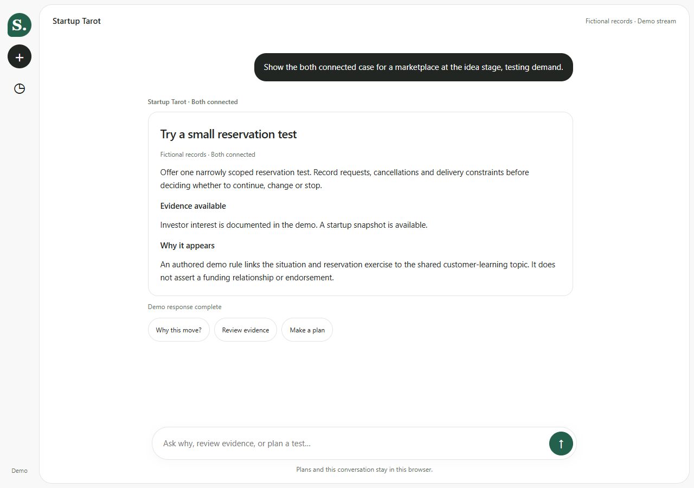

# Startup Tarot Chat

**Explore a next move, inspect its evidence, and save a small learning plan.**



A guided chat prototype using the actual [OpenUI](https://www.openui.com/) renderer, inspired by [Open Intelligent UI](https://github.com/thesysdev/open-intelligent-ui).

**All records and connections are fictional. Replies are scripted and streamed for demonstration; no language model or researched Guide Pack is connected.**

## Try it

1. [Download the ZIP](https://github.com/hmc62843u/startup-tarot-chat/archive/refs/heads/main.zip), unzip it, and open **chat.html** in Chrome. No installation or API key is needed.
2. Choose **Both connected**, **Investor only**, **Startup only**, or **Neither**.
3. Ask **Why this move?**, **Review evidence**, or **Make a plan**. You can also type “why”, “evidence”, or “plan”.
4. Save your plan, refresh, and check that it remains.

Internet access loads the pinned OpenUI browser bundle from jsDelivr. If it cannot load, the same response appears as plain text. Opening index.html also takes you to the chat.

## What you can explore

| Case | What the demo can support |
| --- | --- |
| Both connected | An explicit fictional rule links an investor topic and startup snapshot |
| Investor only | Relevant investor interest, without a supporting startup snapshot |
| Startup only | A startup example, without documented investor interest |
| Neither | Your own learning plan, without a library-supported recommendation |

The demo situation is **marketplace · idea stage · demand question**. Rules select records; the renderer presents them. Similarity does not establish funding, endorsement or causation.

Responses appear progressively. **Stop** preserves the delivered portion, including after refresh. This is scripted playback at one OpenUI statement per 120 ms, not model latency. There is no resume control.

**New chat** saves the current conversation in **Chat history**, which keeps the ten most recent previous chats. Plans and conversations stay in your browser. Private browsing, different profiles and clearing site data affect saved work.

## Development

- [chat.html](chat.html), [chat.css](chat.css), [chat.js](chat.js): chat interface, streaming, history and plan saving.
- [demo-data.js](demo-data.js): fictional records and cases.
- [rules.js](rules.js): deterministic evidence matching.
- [renderer.html](renderer.html): original single-card experiment.

With Node installed, run the rule regression checks:

```sh
node --test tests/rules.test.cjs
```

Real Guide Packs and a live conversation provider are future integrations. This app does not install a Codex plugin or register an MCP server. The main [Startup Tarot app](https://github.com/hmc62843u/startup-tarot) and [Guide Pack Kit](https://github.com/hmc62843u/guide-pack-kit) are separate projects.

Original code and fictional examples: [MIT](LICENSE). OpenUI retains its [upstream MIT licence](https://github.com/thesysdev/openui/blob/main/LICENSE). Independent prototype; no affiliation with or endorsement by Thesys.
